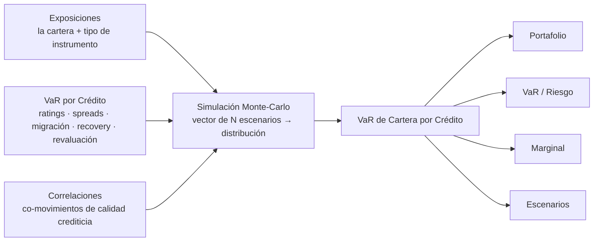

# Crédito — Handoff Metodológico para Diseño UX/UI

> **Propósito.** Guía para diseñar el *mock-up* de la sección **Crédito** de la
> plataforma Risk Intelligence. No es un listado exhaustivo de componentes: es la
> **recomendación de un analista de riesgo** sobre *qué tipo de análisis* tiene
> sentido en crédito, qué KPIs y qué familias de gráficos sugerir por pantalla, y
> cómo encaja con la sección **Mercado** existente (paridad de navegación y de
> lenguaje visual).
>
> **Alineación metodológica.** Este documento está alineado con la metodología
> **CreditMetrics™** (CMTD1 Technical Document) y con las presentaciones internas
> **QVAL** (`presentations/ppt1` — marco y aplicaciones; `presentations/ppt2` —
> parámetros del modelo y **adaptación a República Dominicana**). Los nombres
> técnicos se incluyen solo como anclas para conversar con analítica.
>
> **Audiencia.** Diseñadores UX/UI. No requiere leer código.

---

## 1. Modelo mental: qué *es* el análisis de crédito aquí

A diferencia de Mercado —donde el riesgo se **observa** en precios líquidos
diarios y el VaR se calcula directamente— en crédito **no existe** una serie de
precios observable para los cambios de calidad crediticia. CreditMetrics
**construye lo que no puede observar**: la volatilidad de valor debida a cambios
de calidad. Es menos "ajustar distribuciones a precios" y más "proponer un modelo
que explique los cambios". La técnica central es el **análisis de migración**
(*migration analysis*): el estudio de cómo cambia la calidad crediticia (incluido
el default) a lo largo de un **horizonte** (típicamente 1 año).

> **Clave de encuadre para el diseño:** la PD (probabilidad de default) es un
> **insumo**, no la salida. La salida es la **distribución completa de valor del
> portafolio**, y *toda* métrica/gráfico del tablero es una vista de esa misma
> distribución. Esto da coherencia narrativa: cada pantalla mira la misma "nube"
> de escenarios desde otro ángulo.

**Tres ramas de insumos → una salida única** (diagrama-marco CMTD):



**Las cuatro matrices del modelo** (vocabulario CMTD, útil como andamiaje
conceptual del tablero):

| Matriz | Qué es | Dónde se ve en el tablero |
|---|---|---|
| **Transición** | probabilidades de migrar de rating (incl. default) en el horizonte; internacional (Moody's/S&P) | mecanismo detrás de VaR/Escenarios |
| **Exposición** | la cartera del cliente (posiciones, tipo de instrumento) | Portafolio |
| **Valores** | motor que revalúa cada instrumento a NPV bajo cada evento crediticio | toda métrica de valor/pérdida |
| **Correlación** | dependencia entre emisores (el componente **no observable** en RD; ver §2) | Factores de Riesgo, Marginal, Escenarios |

---

## 2. Contexto República Dominicana — qué cambia (y por qué importa al diseño)

La cartera real es **deuda dominicana en DOP**: *bonos, SBB, SBB con garantía,
certificados de depósito (CDs)*. La adaptación QVAL (`ppt2`) documenta que **tres
objetos que CreditMetrics asume observables, en RD no lo son**:

1. **Equity de los emisores no observable** → no hay retorno de activos por emisor.
2. **Retornos de deuda agrupados por rating, no por emisor** → la **matriz de
   correlación firma-firma es no observable**.
3. **Matriz de transición local no observable** → se usa una **internacional
   mapeada** a la escala local (aceptable: el rating es una abstracción comparable).

Existen **dos alternativas metodológicas** para el único bloque en disputa (la
generación de escenarios crediticios conjuntos); el resto del *pipeline* es común:

- **Alt 1 — Cópula empírica:** sortea eventos de rating conjuntos directamente de
  tablas empíricas de co-migración (sin modelo de Merton). Defensa: "data
  observada de agencia".
- **Alt 2 — Asset-return con tres atajos:** conserva los *thresholds* de Merton y
  el muestreo normal correlacionado, pero **fija ρ axiomáticamente** (típico
  20–35%), aproxima el retorno de activo por el de la deuda, y usa **una
  distribución por categoría de rating**. Defensa: "CreditMetrics estándar".

> **Implicaciones de diseño (no negociables):**
> - El **rating es el eje primario** de *drill-down*; el "emisor" se diferencia
>   por **exposición y realización aleatoria**, no necesariamente por una
>   distribución propia (en Alt 2 dos BBB son idénticos en distribución). No
>   prometer visualmente una granularidad emisor-específica que el modelo no tiene.
> - El **supuesto activo debe ser visible** (badge/leyenda: fuente de transición,
>   método de correlación, ρ usado). El tablero debe ser **auditable**.
> - La **sensibilidad a los supuestos** (sobre todo **ρ**) es un entregable de
>   primera clase, no un VaR puntual. Reservar espacio de UI para "barrer" ρ
>   ∈ {15%, 25%, 35%} y comparar (ver §7.4 Escenarios y §8 Sensibilidades).
> - Moneda base **DOP**.

---

## 3. Los "factores de riesgo" en clave de crédito

El equivalente crediticio de los factores de mercado (tasa, FX, vol):

| Factor de crédito | Qué representa | Insumo del modelo |
|---|---|---|
| **Migración / transición** | subir o bajar de calificación en el horizonte | matriz de transición internacional |
| **Default** | evento de incumplimiento | última columna de la transición |
| **Correlación** | contagio sistémico (shock común golpea a muchos) | ρ / cópula (el componente abierto en RD) |
| **Recovery / LGD** | cuánto se recupera tras default | distribución **Beta** por seniority (μ, σ) |
| **Spread / curva por rating** | revaluación del bono al cambiar de rating | curva *forward* cupón-cero por calificación |

> **Nota visual:** un **default** produce una caída de valor **mucho mayor** que
> cualquier migración non-default. Por eso el riesgo lo **conduce el conteo de
> defaults** — y por eso la distribución es asimétrica y multimodal (§4, §7.4).

---

## 4. Medidas de riesgo — vocabulario y forma de la distribución

CreditMetrics caracteriza el riesgo con **dos medidas canónicas** más una de cola
moderna; el tablero las expone con el selector **VaR · ES · Std**:

| Selector | Medida CMTD | Lectura | Uso recomendado |
|---|---|---|---|
| **Std** | desviación estándar **σ** | dispersión simétrica del valor | **límites / ranking** (rápida, analítica) — pero *bilateral*, engaña en cola |
| **VaR** | **percentil** (p.ej. 1%) | "pérdida peor que esta solo el 1% del tiempo" | medida concreta, leída de los escenarios simulados ordenados |
| **ES** | *expected shortfall* / *expected excession* | "en el peor 1%, pérdida esperada = X" | **capital económico** (interpretación de cola fuerte) |

> **Regla metodológica (CMTD §12.2.2):** **σ para límites** (velocidad), **percentil
> / ES para capital** (interpretación de cola). Diséñese el selector para que el
> cambio de medida sea barato y no altere el layout.

**La forma de la distribución importa para el diseño** (CMTD §11):

- **Unilateral (solo downside):** alta probabilidad de pequeña ganancia, baja
  probabilidad de pérdida grande → **fuerte asimetría a la izquierda**.
- **Multimodal:** jorobas sucesivas = escenarios con **0, 1, 2, 3… defaults**.
- **No-normal:** la distribución simulada es **más pesada en la cola** que una
  normal con la misma σ. **No dibujar una campana de Gauss**: la silueta de
  referencia es sesgada y con jorobas (la σ por sí sola no describe la cola).

---

## 5. Estructura de navegación (paridad con Mercado)

Mercado se organiza en: *Visión General, VaR-y-ES, Factores de Riesgo, Portafolio,
Sensibilidades, Escenarios, Backtesting*. La recomendación es **reflejar ese
esqueleto** en Crédito: activar primero el **núcleo de 4 secciones** (el sketch
recuperado) y dejar el resto como extensión natural.

| # | Sección Crédito | Estado | Equivalente Mercado | Selector |
|---|---|---|---|---|
| 1 | **Portafolio** | núcleo | Portafolio | — |
| 2 | **VaR / Riesgo** | núcleo | VaR-y-ES | **VaR · ES · Std** |
| 3 | **Marginal** | núcleo | VaR-y-ES › Marginal | **VaR · ES · Std** |
| 4 | **Escenarios** | núcleo | Escenarios | — |
| 5 | *Factores de Riesgo* | recomendado | Factores de Riesgo | — |
| 6 | *Sensibilidades* | recomendado | Sensibilidades | — |
| 7 | *Backtesting* | recomendado | Backtesting | — |
| 8 | *Visión General / Aplicaciones* | recomendado | Visión General | resumen |

Menú lateral izquierdo (`MenuSidebar`, título **"Crédito"**); pantalla por defecto
**VaR**.

---

## 6. Patrón de pantalla (rejilla 2×2 + tira de KPIs)

Las 4 secciones núcleo comparten **un mismo molde** reutilizable:

```
┌───────────────────────────────────────────────────────────┐
│  Breadcrumb: Crédito › <Sección>      [ VaR · ES · Std ]   │  ← selector (solo VaR y Marginal)
│                                       [ supuesto: ρ=25% · S&P ]│ ← badge de supuesto activo (§2)
├───────────────────────────────────────────────────────────┤
│  Tabs: VaR · Marginal · Portafolio · Escenarios           │
├──────────────┬────────────────────────────────────────────┤
│  KPI 1       │                                            │
│  KPI 2       │     TL (gráfico)        TR (gráfico)        │
│  KPI 3       │                                            │
│  KPI 4       │     BL (gráfico)        BR (tabla)          │
│  (tira 4-5)  │     rejilla 2×2                            │
└──────────────┴────────────────────────────────────────────┘
```

- **Tira de KPIs (4 tarjetas):** valor **actual vs. anterior + variación (Δ y %)**
  con indicador de tendencia. El "primer vistazo".
- **Rejilla 2×2:** TL/TR/BL/BR = cuatro paneles; **BR suele ser una tabla**
  detallada y exportable.
- **Selector de medida (VaR·ES·Std):** solo donde aplica; recalcula sin cambiar layout.
- **Badge de supuesto activo:** fuente de transición · método/valor de correlación.
- **Drill-down canónico:** **rating · emisor · sector · tipo de instrumento**.

---

## 7. Detalle por sección (qué analizar + gráficos sugeridos)

### 7.1 Portafolio — *composición y concentración* (sin medida de riesgo)
**Pregunta:** ¿de qué está hecho el libro y cómo cambió? Es análisis de
**exposición y concentración**, previo a cualquier simulación. La
**concentración** es *la* motivación del enfoque de cartera en crédito (muchos
nombres no garantizan diversificación si están correlacionados — p.ej. todos
bancos del mismo país).

- **KPIs:** Valor de Mercado Total · N° Posiciones · N° Emisores · Calificación
  predominante (mayor *share* por rating).
- **Gráficos sugeridos:**
  - **Área apilada temporal** — VM por **rating** en el tiempo (evolución de la
    mezcla de calidad).
  - **Dona / treemap** — composición por **rating / emisor / tipo de instrumento**.
  - **Barras divergentes "cambio"** — variación por grupo vs. fecha de referencia.
  - **Tabla** — por rating: VM, % Global, Var DOP, Var %.
- **Métricas a destacar:** **HHI** (Herfindahl) y *top-N* emisores.

### 7.2 VaR / Riesgo — *la medida de riesgo por dimensión y en el tiempo* (selector VaR·ES·Std)
**Pregunta:** ¿cuánto puedo perder, dónde se concentra y cómo evoluciona? Corazón
cuantitativo. La distribución de valor es **asumida / simulada** (no observada), de
modo que la sección **no** la contrasta contra una "empírica": el foco es la
**medida de riesgo** (VaR, CVaR, Std) **recortada por dimensión y en el tiempo**.

- **KPIs:** \<Medida\> Total (vs. anterior) · razón Medida/VM · **Top Driver**
  (emisor que más aporta) · Volatilidad anualizada (σ·√252).
- **Gráficos sugeridos** (el **mismo set para cada medida que se defina** — VaR,
  CVaR, Std — alternada por el selector):
  - **Métrica × tiempo** — serie temporal de la medida (evolución del riesgo del libro).
  - **Métrica × calificación** — barras de la medida por **rating**.
  - **Dona por emisor** — contribución de la medida por **emisor** (top-8 + "Otros").
  - **Cambio en la métrica vs. anterior** — barras divergentes (Δ de la medida por grupo).
  - **Descomposición de la métrica (tabla)** — desglose jerárquico (rating →
    emisor / sector), actual vs. anterior.

### 7.3 Marginal — *contribución por posición* (selector VaR·ES·Std)
**Pregunta:** ¿qué posición **añade** más riesgo al portafolio en el margen (no en
aislamiento)? Definición CMTD: el riesgo **marginal** de un activo = riesgo(cartera
completa) − riesgo(cartera **sin** ese activo); la **brecha vs. el riesgo
individual** es el **beneficio de diversificación**. Generaliza a σ y a percentiles.

- **KPIs:** Marginal promedio · Mayor contribución (posición) · Posiciones sobre
  umbral · **Concentración HHI** de contribuciones.
- **Gráficos sugeridos:**
  - **Scatter "riesgo-vs-tamaño" (nube iso-risk)** — el gráfico que pediste como
    "**iso curve plot**". Eje X = Valor de Mercado de la posición; eje Y = **riesgo
    marginal %**. Cada punto = un instrumento. Lectura por **cuadrantes** (CMTD §12.1):
    - **A — inferior derecha:** mayor **tamaño absoluto** (un default pega fuerte en DOP).
    - **B — superior izquierda:** mayor **% de riesgo**.
    - **C — superior derecha (recomendado):** mayor **riesgo absoluto** — los que
      conducen la σ del portafolio. Aquí viven los ***fallen angels*** (exposición
      grande dimensionada cuando el rating era alto, luego degradado).
    - **Overlays de límite:** línea **horizontal** (límite de %-riesgo ≈ piso de
      rating), línea **vertical** (límite de tamaño de exposición), e **hipérbola
      iso-risk** (límite de riesgo absoluto — el recomendado; topea la σ total).
  - **Dona** de contribución por instrumento/emisor.
  - **Barras ranking** — top posiciones por riesgo marginal.
  - **Tabla** por posición: VM, marginal, individual (*standalone*), % del total.

### 7.4 Escenarios — *estrés del libro y de los supuestos*
**Pregunta:** ¿qué pasa con mi P&L bajo estrés? Opera sobre **dos distribuciones**
(base vs. shockeada). Dos familias de shock, ambas relevantes en RD:

- **Shocks del libro / crédito:** subida de **PD**, **N defaults** forzados, **N
  downgrades** (rebajas de *notch*).
- **Shocks de supuesto (clave en RD, §2):** **barrido de ρ** (p.ej. 15/25/35%),
  **fuente de transición** (S&P vs. Moody's), **recovery (μ, σ)** por seniority.
  Es la sensibilidad-a-supuestos elevada a entregable de primera clase.

- **KPIs:** VM Pre-Shock · VM Post-Shock · G/P Total (Δ y %) · Driver principal
  (emisor con mayor pérdida).
- **Gráficos sugeridos:**
  - **Barras divergentes de P&L por rating** — (shock − base).
  - **Histograma de valores del portafolio chocado** — la distribución *post-shock*
    con su línea de VaR; opcionalmente **superpuesto** al base para ver cómo se
    engorda la cola.
  - **Waterfall (cascada)** — descomposición de la pérdida por instrumento.
  - **Tabla** por instrumento: VM Pre / Post / G-P.
- **UX de control:** panel de configuración del shock (tipo, magnitud, selección de
  emisores/notches; o el parámetro de supuesto a barrer) que dispara el recálculo.

---

## 8. Secciones recomendadas (extensión, paridad con Mercado)

No estaban en el sketch de 4 secciones, pero un analista las espera:

- **Factores de Riesgo** — desglose del VaR por **factor crediticio** (migración,
  default, correlación, recovery, spread). Gráficos:
  - **Umbrales de Merton** — densidad normal estándar con las **fronteras Z de
    rating**, sombreando la **cola de default**. Explica el mecanismo
    migración→default (base de Alt 2).
  - **Barras de contribución por factor** (atribución tipo Euler).
- **Sensibilidades** — en crédito, la sensibilidad más **defendible** es la
  **paramétrica a los supuestos** (ρ, (μ,σ) por rating, fuente de transición):
  *tornado chart* / barras de impacto en VaR por supuesto. A futuro, sensibilidad
  de valor a *spread* (**CS01 / spread duration**) cuando haya *greeks* por posición.
- **Backtesting** — validación del VaR: serie de **excepciones**, pruebas
  estadísticas (**Kupiec POF**, **Christoffersen**), semáforo de estados/umbrales.
  *Caveat de muestreo:* las colas profundas (0.5%, 0.1%) tienen bandas de confianza
  anchas — escala ~1/q en número de escenarios; reflejarlo visualmente.
- **Visión General / Aplicaciones** — resumen + traducción a política: **capital
  económico** (¿cuánto capital consume la cartera?), **RAROC**, **cuadrante de
  priorización** de reducción de riesgo, **límites jerárquicos** (name → industria
  → sector → cartera; límite condicional por *name* coexiste con el de riesgo).

---

## 9. Catálogo de gráficos recomendados (vocabulario visual)

Tratar como **librería de componentes** reutilizable.

| Gráfico | Dónde | Para qué |
|---|---|---|
| **Histograma de valores del portafolio (asimétrico, multimodal) + líneas VaR/ES** | Escenarios | distribución simulada y sus cuantiles de cola |
| **Zoom multinivel del histograma** (cuerpo / banda / cola) | Escenarios | la cola vive ~200× más abajo que el cuerpo |
| **Scatter riesgo-vs-tamaño (iso-risk)** + cuadrantes + barreras | Marginal, Aplicaciones | tamaño vs. riesgo marginal por posición; priorización y límites |
| **Dona / treemap de concentración** | Portafolio, VaR, Marginal | mezcla y aporte por rating/emisor/sector/tipo |
| **Área apilada temporal** | Portafolio, VaR | evolución de composición/riesgo por grupo |
| **Barras divergentes** | Portafolio (cambio), VaR (cambio), Escenarios (P&L) | ganadores/perdedores vs. referencia |
| **Waterfall (cascada)** | Escenarios | descomposición aditiva del P&L por instrumento |
| **Tabla de desglose** | todas (panel BR) | detalle exportable actual vs. anterior |
| **Umbrales de Merton** (normal con fronteras Z) | Factores de Riesgo | mecanismo migración→default |
| **Heatmap de correlación** (matriz ρ asumida) | Factores de Riesgo | tangibiliza el supuesto ρ |
| **Tornado / barras de sensibilidad a supuestos** | Sensibilidades, Escenarios | impacto en VaR de ρ, (μ,σ), fuente de transición |
| **Traza de convergencia + bandas de confianza** | Backtesting / diagnóstico | estabilidad Monte-Carlo; colas necesitan más escenarios |
| **Serie de excepciones + semáforo** | Backtesting | violaciones de VaR y pruebas estadísticas |
| **Cuadrante de priorización + límites jerárquicos** | Aplicaciones | de números de riesgo a política |

---

## 10. Patrones transversales de UX

- **Selector de medida** (VaR · ES · Std): *segmented control* arriba a la derecha;
  solo VaR y Marginal. Cambia datos, **no** layout. (σ→límites, VaR/ES→capital.)
- **Badge de supuesto activo:** fuente de transición + método/valor de correlación;
  el tablero debe ser **auditable** y honesto sobre los supuestos (§2).
- **Tarjeta KPI:** valor grande + (anterior, Δ, Δ%) + tendencia. Idéntico en las 4 secciones.
- **Drill-down canónico:** **rating · emisor · sector · tipo de instrumento**
  (rating = eje primario; emisor diferenciado por exposición, no por distribución).
- **Estado de datos / fecha (`as_of`)** y badge de dataset, como en Mercado.
- **Estados vacíos / "N/D":** límites o métricas sin valor renderizan "N/D".
- **Moneda DOP:** separador de miles; abreviar montos grandes en tarjetas (M/MM).
- **No-objetivo explícito:** esto **no** es un modelo de *pricing* de crédito (CMTD §12.0).

---

## 11. Glosario rápido (para tooltips y etiquetas)

- **Análisis de migración:** estudio de los cambios de rating (incl. default) en el tiempo — técnica central.
- **VaR / percentil:** pérdida que no se excede con cierta confianza (p.ej. 99%).
- **ES / Expected Shortfall / *expected excession*:** pérdida **media** en los escenarios peores que el VaR.
- **σ (desviación estándar):** dispersión simétrica; rápida pero bilateral (engaña en colas).
- **Riesgo marginal:** riesgo que una posición **añade** al portafolio = riesgo(con) − riesgo(sin). La brecha vs. el individual = **diversificación**.
- **Umbrales de Merton (Z):** fronteras sobre el retorno de activo estandarizado que mapean a cada rating; cruzar el inferior = default.
- **Cópula:** mecanismo que enlaza los destinos de los emisores (riesgo sistémico vs. idiosincrático).
- **ρ (correlación de activos):** parámetro clave de la cola; **no observable en RD** → fijado/empírico (§2).
- **Recovery / LGD:** fracción recuperada tras default (LGD = 1 − recovery); Beta por seniority.
- **PD:** probabilidad de incumplimiento (insumo, no salida).
- ***Fallen angel*:** deudor dimensionado con rating alto que luego se degrada → salta a riesgo absoluto alto.
- **HHI:** índice de concentración (suma de cuadrados de pesos).
- **Capital económico / RAROC:** capital que consume la cartera / retorno ajustado por riesgo (aplicaciones, §8).
- **Iso-risk:** curva de igual riesgo absoluto en el plano tamaño-vs-riesgo%.

---

### Anexo — origen del material
Recuperado y alineado con: **CMTD1** (CreditMetrics™ Technical Document) y las
presentaciones **QVAL** `ppt1` (marco de medición + aplicaciones: simulación
Monte-Carlo, ejemplo de 20 bonos, límites y capital) y `ppt2` (parámetros del
modelo: migración, recovery Beta, correlaciones, y **adaptación a República
Dominicana** con las dos alternativas de *sampler*). Complementado con el *sketch*
de crédito (4 secciones: portafolio, riesgo, marginal, escenarios), la metodología
en `librisk.credit`, la API de gráficos `librisk.credit.plotting`, las analíticas
`libriskanalytics`, y la estructura actual de la sección **Mercado** (paridad).
